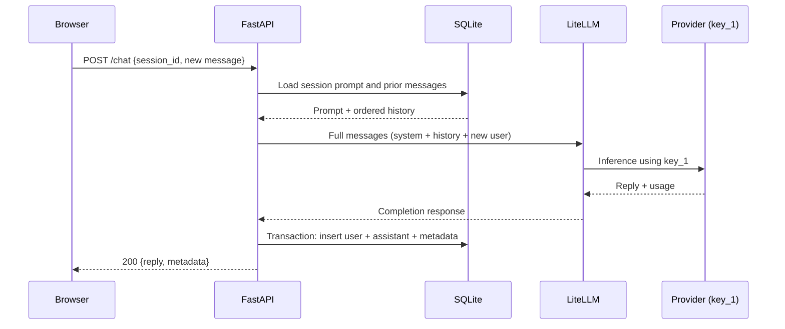
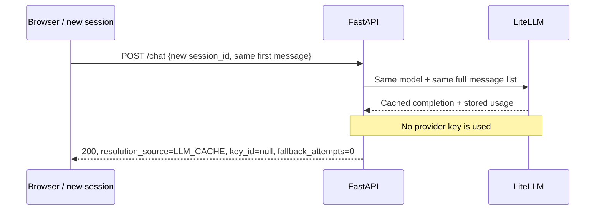

# Architecture

## 1. Architecture goals

Build a small, deployable full-stack chatbot that is easy to test and explain. The architecture must satisfy the assignment's exact API/UI contract while keeping provider-specific logic, persistence, and presentation separate.

**Required stack**

| Layer | Technology |
|---|---|
| Frontend | React (Vite + TypeScript recommended) |
| Backend | Python + FastAPI |
| LLM gateway | LiteLLM |
| Persistence | SQLite only |
| Cache | LiteLLM built-in in-memory or disk cache |
| Local orchestration | Docker Compose + Makefile |
| Tests | pytest for backend; frontend component/interaction tests where practical |

Do not add Redis or PostgreSQL. The only persistent application database is SQLite.

## 2. High-level system view

```mermaid
flowchart LR
    U[User / Browser] --> FE[React Frontend :3000]
    FE -->|POST /chat: session_id + new message| API[FastAPI Backend :8000]
    FE -->|GET /sessions/{id}/messages| API
    API --> DB[(SQLite on named volume /data)]
    API --> SVC[Chat Service]
    SVC -->|system prompt + stored history + new message| GW[LiteLLM Router / Gateway]
    GW --> CACHE[(LiteLLM built-in cache)]
    GW --> K1[Provider deployment: key_1]
    GW --> K2[Provider deployment: key_2]
    GW -. fallback .-> K2
    API -->|JSON reply + request metadata| FE
```

The cache is part of LiteLLM's request path. The application must not implement a separate hand-written response cache.

## 3. Repository structure

Use this as the target layout. Existing repositories may have different names, but keep the same separation of responsibilities and preserve working code after inspection.

```text
repo-root/
├── backend/
│   ├── app/
│   │   ├── main.py                 # FastAPI app, startup/shutdown
│   │   ├── api/
│   │   │   └── routes.py           # Exactly the three public API routes
│   │   ├── core/
│   │   │   ├── config.py            # Environment settings and validation
│   │   │   └── logging.py           # Safe structured logging
│   │   ├── db/
│   │   │   ├── connection.py        # SQLite connection/session helpers
│   │   │   ├── schema.py            # Startup schema creation
│   │   │   └── repository.py        # Session and message persistence
│   │   ├── llm/
│   │   │   ├── gateway.py           # LiteLLM Router, keys, fallback
│   │   │   ├── cache.py             # LiteLLM cache configuration/detection
│   │   │   └── failure_simulation.py # Request-scoped test hook
│   │   ├── services/
│   │   │   └── chat_service.py      # Build prompt, call model, save response
│   │   └── schemas.py               # Pydantic request/response models
│   ├── tests/
│   │   ├── conftest.py
│   │   ├── test_health.py
│   │   ├── test_chat.py
│   │   ├── test_sessions.py
│   │   ├── test_failover.py
│   │   └── test_cache.py
│   ├── requirements.txt             # Or pyproject.toml, choose one source of truth
│   └── Dockerfile                   # Multi-stage build
├── frontend/
│   ├── src/
│   │   ├── app/
│   │   │   └── App.tsx
│   │   ├── components/
│   │   │   ├── ChatHeader.tsx
│   │   │   ├── ChatTranscript.tsx
│   │   │   ├── MessageBubble.tsx
│   │   │   ├── MessageMetadata.tsx
│   │   │   ├── ChatComposer.tsx
│   │   │   ├── SystemPromptControl.tsx
│   │   │   └── ErrorNotice.tsx
│   │   ├── services/
│   │   │   └── chatApi.ts           # Typed fetch wrappers for backend
│   │   ├── types/
│   │   │   └── chat.ts              # API request/response types
│   │   ├── utils/
│   │   │   └── sessionId.ts         # Generate a new ID on page load
│   │   ├── styles/
│   │   │   └── global.css
│   │   └── main.tsx
│   ├── package.json
│   ├── vite.config.ts
│   └── Dockerfile                   # Multi-stage build
├── docker-compose.yml
├── Makefile
├── .env.example
├── .gitignore
├── README.md
├── PRD.md
├── Architecture.md
├── Rules.md
├── Phases.md
├── Design.md
└── AGENT_PROMPT.md
```

The agent creates `MEMORY.md` only when coding begins. It is intentionally not part of the initial planning files.

## 4. Backend component responsibilities

### 4.1 FastAPI application (`main.py`)

- Load and validate environment configuration.
- Initialize SQLite schema on startup.
- Initialize the LiteLLM cache and key pool/router on startup.
- Configure CORS from `ALLOWED_ORIGINS`.
- Register only these application routes:
  - `GET /health`
  - `POST /chat`
  - `GET /sessions/{session_id}/messages`
- Disable FastAPI's interactive docs/OpenAPI routes in the deployed application if necessary to preserve the requirement that the backend exposes exactly these three routes.
- Return JSON errors consistently.

### 4.2 Configuration (`core/config.py`)

Required settings:

- `LLM_API_KEYS`: comma-separated list; trim whitespace and reject missing/empty keys; at least two keys for a valid configured deployment.
- `DATABASE_URL`: SQLite URL. Docker default should point to `/data/app.db`.
- `ALLOWED_ORIGINS`: comma-separated origins.
- `ENABLE_FAILURE_SIMULATION`: boolean.

Additional recommended settings:

- `LLM_MODEL`: LiteLLM model identifier such as `<provider>/<model-name>`.
- `LLM_API_BASE`: optional provider-compatible base URL if required.
- `LLM_TEMPERATURE`: fixed/default generation setting so equivalent requests have consistent cache identity.
- `LLM_MAX_TOKENS`: configured completion cap.
- `DEFAULT_SYSTEM_PROMPT`: application default when no session override exists.
- `LITELLM_CACHE_TYPE`: `local` or `disk`, with a documented default.

Never put actual keys in source code, `.env.example`, frontend variables, logs, or README screenshots.

### 4.3 SQLite persistence (`db/`)

Use the built-in Python `sqlite3` module unless a thin database abstraction materially simplifies the code. The database file must be resolved from `DATABASE_URL` and stored at `/data/app.db` in Docker.

Required `messages` table:

```sql
CREATE TABLE IF NOT EXISTS messages (
    id INTEGER PRIMARY KEY AUTOINCREMENT,
    session_id TEXT NOT NULL,
    role TEXT NOT NULL CHECK (role IN ('user', 'assistant')),
    content TEXT NOT NULL,
    metadata TEXT,
    created_at TEXT NOT NULL
);
```

Recommended indexes:

```sql
CREATE INDEX IF NOT EXISTS idx_messages_session_id_id
ON messages(session_id, id);
```

Recommended `sessions` table (allowed by the PDF and useful for optional system-prompt persistence):

```sql
CREATE TABLE IF NOT EXISTS sessions (
    session_id TEXT PRIMARY KEY,
    system_prompt TEXT,
    created_at TEXT NOT NULL
);
```

Persistence rules:

- `messages` contains only `user` and `assistant` chat turns.
- `metadata` is `NULL` for user messages and a JSON string for assistant messages.
- `created_at` uses server-generated ISO-8601 time.
- Retrieve messages ordered by ascending `id` (or equivalent server order) to return oldest first.
- A failed chat request must not create a new session row or save either side of the failed turn.
- Save the user and assistant records in a single transaction after the model returns successfully.
- The history endpoint must not expose the system prompt.

### 4.4 LiteLLM gateway (`llm/`)

Configure one LiteLLM deployment per key (or an equivalent LiteLLM-supported routing configuration) with deterministic identifiers `key_1`, `key_2`, etc. The deployment list follows the order in `LLM_API_KEYS`. All deployments may use the same configured model; separate models may be used only when configuration remains transparent and responses identify the model that actually answered.

The gateway must:

- use LiteLLM Router/gateway facilities for the key pool and fallback behavior;
- retry/fail over to another key for rate limits (429), quota errors, and provider 5xx/unavailable errors;
- expose the successful safe key ID and the count of failed keys before success;
- normalize exhausted-key errors to the exact 503 response contract;
- use the built-in LiteLLM cache, not a custom dictionary or database cache;
- detect whether a response came from cache using supported LiteLLM response/cache metadata for the pinned installed version;
- return the actual model name and usage values from the response;
- never leak the API key in exceptions, logs, API responses, or metadata.

Do not guess at LiteLLM response internals. Pin a compatible LiteLLM version and verify its Router, fallback, cache-hit, and key/deployment-identification behavior with tests. If an internal field differs by version, adapt the integration rather than weakening the external API contract.

### 4.5 Failure simulation (`llm/failure_simulation.py`)

- Parse `X-Simulate-Failure` only when `ENABLE_FAILURE_SIMULATION=true`.
- Accept comma-separated `key_id=status` pairs and `*=status`.
- Accept only statuses 429, 500, 502, and 503.
- Apply the simulated error to the specified key deployment for this request only.
- Do not modify actual keys or future requests.
- Ensure the request bypasses LiteLLM response-cache lookup so a cache hit cannot hide the simulated failure path. Verify the selected LiteLLM call-level cache-disable mechanism for the pinned version.
- For a successful fallback, continue to the real next configured key and return its actual model reply.
- For a simulation that makes all keys fail, return the exact 503 body and persist nothing.

### 4.6 Chat service (`services/chat_service.py`)

Recommended request flow:

1. Validate the request using Pydantic/FastAPI.
2. Resolve the session's effective system prompt:
   - if `system_prompt` is provided for this request, use it as the session override;
   - otherwise use the stored session override, if present;
   - otherwise use `DEFAULT_SYSTEM_PROMPT`.
3. Load the session's messages from SQLite in oldest-first order. Unknown `session_id` on `POST /chat` is a new session, not a 404.
4. Build the complete ordered LLM message list:
   - system prompt;
   - each stored user/assistant message;
   - the new user message.
5. Call LiteLLM with a stable model and generation configuration. Do not pass `session_id` as an LLM parameter or part of the cache identity.
6. For normal requests, allow LiteLLM cache lookup. For an enabled failure-simulation request, bypass cache so the key-failure hook is exercised.
7. Measure server-side latency in milliseconds for this request.
8. Extract actual input/output token usage and determine `LIVE_INFERENCE` versus `LLM_CACHE`.
9. On live inference, report the successful `key_id` and `fallback_attempts`. On cache hit, report `key_id: null` and `fallback_attempts: 0`.
10. Only after successful completion, create/update the session and insert both the new user message and assistant reply in one SQLite transaction.
11. Return the exact JSON response contract.

If the provider does not return token usage, use an explicitly documented LiteLLM-supported token-counting fallback. Do not fabricate counts or display conversation totals.

### 4.7 API routes and schemas

Keep request/response models in `schemas.py`; routes should be thin and delegate to services/repositories.

**`GET /health`**

- Verify the SQLite file can be opened and queried.
- Report actual key count.
- Report cache state.
- Return the required JSON names exactly.

**`POST /chat`**

- Required request fields: `session_id`, `message`; optional: `system_prompt`.
- Enforce 1-128 characters for `session_id` and 1-4000 trimmed characters for `message`.
- Accept the `X-Simulate-Failure` header.
- Response top level: `session_id`, `reply`, `metadata`.
- Metadata required fields: `resolution_source`, `model`, `latency_ms`, `input_tokens`, `output_tokens`, `key_id`, `fallback_attempts`.

**`GET /sessions/{session_id}/messages`**

- Check the `sessions` table (or equivalent authoritative session marker).
- Unknown session -> 404 `{"detail":"session not found"}`.
- Return oldest-first `messages` with roles and content; add metadata only for assistant messages.
- Never return the system prompt.

### 4.8 Error handling

- Request validation/malformed JSON -> HTTP 422 JSON with `detail`.
- All keys exhausted -> HTTP 503 JSON with exact detail `all providers unavailable`.
- Unknown history session -> HTTP 404 JSON with exact detail `session not found`.
- Do not add failed request content to SQLite.
- Do not expose Python stack traces or HTML exception pages.
- Unexpected internal errors should be safely logged server-side and converted to a generic JSON detail; preserve the specifically required 503/422/404 mappings.

## 5. Frontend component architecture

### 5.1 Application lifecycle

- Generate a fresh client-side `session_id` exactly once when the page loads.
- Do not reuse a previous session ID from localStorage/sessionStorage; the assignment explicitly says each page load starts a new session.
- Keep the current session ID in React state for the lifetime of the page.
- The frontend stores the visible transcript in component state for rendering, but sends only the latest user message to the backend.

### 5.2 API client (`services/chatApi.ts`)

- Read backend base URL from a build/runtime environment variable, e.g. `VITE_API_BASE_URL`.
- Send JSON to `POST /chat` with `session_id`, `message`, and optional `system_prompt`.
- Do not send the full transcript.
- Parse JSON error bodies and surface their `detail` text.
- Use typed request and response definitions matching the API contract.

### 5.3 UI components

- `ChatHeader`: product label and concise connection/status context.
- `ChatTranscript`: scrollable message history and empty state.
- `MessageBubble`: user or assistant message content.
- `MessageMetadata`: source, model, latency, input tokens, and output tokens for one assistant response.
- `ChatComposer`: textarea, send action, keyboard handling, disabled/loading state.
- `SystemPromptControl`: optional session-level system prompt field.
- `ErrorNotice`: readable inline 422/503/general error presentation.

Use the exact test IDs from the PRD:

- `chat-input`
- `send-button`
- `assistant-message` on every assistant reply container
- `meta-source`
- `meta-model`
- `meta-latency`
- `meta-input-tokens`
- `meta-output-tokens`
- `system-prompt-input` only when system-prompt UI is implemented

Each metadata test ID must be inside its corresponding `assistant-message` container. Avoid putting multiple metadata fields under a single test ID.

### 5.4 Frontend request states

- **Idle:** input enabled and send button available.
- **Sending:** prevent accidental duplicate submissions; show a visible pending state.
- **Success:** append the user message and assistant response with metadata; clear the input.
- **Error:** show a readable error in the chat; do not pretend an assistant answer was generated or append a failed turn to the persistent transcript. Keep the typed message available for retry where practical.
- **Empty page:** show a short example prompt or welcome state, but do not pre-seed fake chat messages.

## 6. Request/data flow

### 6.1 Normal live inference



### 6.2 Cache hit



The cache identity must not include `session_id`, allowing the same first message in different sessions to reuse the result.

### 6.3 Failover

```mermaid
sequenceDiagram
    participant B as Browser
    participant F as FastAPI
    participant L as LiteLLM Router
    participant K1 as key_1 deployment
    participant K2 as key_2 deployment
    B->>F: POST /chat + X-Simulate-Failure: key_1=429
    F->>L: Full messages; cache bypassed for this request
    L->>K1: Attempt key_1
    K1-->>L: Simulated 429
    L->>K2: Retry/fallback with key_2
    K2-->>L: Real model completion + usage
    L-->>F: Completion from key_2
    F-->>B: 200, key_id=key_2, fallback_attempts=1
```

If all configured keys fail, no message records are inserted and the API returns HTTP 503 with the required detail.

## 7. Cache and token semantics

- Build the same deterministic prompt message list for equivalent requests.
- Cache key must reflect the model and full ordered messages; any setting that changes model output should be stable and part of the cache identity.
- Do not add request IDs, timestamps, `session_id`, random values, or other per-session values to the LLM prompt or cache key.
- On a cache hit, return the exact reply and original usage values stored with the cached completion.
- `input_tokens` means system prompt + historical messages + the current message for this request. It is not a cumulative conversation total.
- `output_tokens` means only the assistant completion for this request.
- `latency_ms` is measured by the backend. A real cache hit should naturally be faster than a live provider call; do not falsify latency values to force the comparison.

## 8. Docker and local deployment

### 8.1 Docker Compose

Root `docker-compose.yml` runs:

- `backend`: FastAPI on container port 8000, published at `localhost:8000`;
- `frontend`: React production build served on container port 3000, published at `localhost:3000`;
- named volume mounted from the backend container to `/data` for SQLite.

For browser requests from a locally served frontend, the Vite build-time API base URL must resolve to `http://localhost:8000` (not the Compose-only hostname `backend`).

### 8.2 Makefile

- `make up`: build and start both services.
- `make down`: stop/remove the containers and network but retain the named SQLite volume.

### 8.3 Multi-stage images

- Backend: dependency/build stage and slim Python runtime stage.
- Frontend: Node build stage and small static web-server runtime stage.
- Do not copy `.env` files or secrets into either image.

### 8.4 SQLite volume

Set the container `DATABASE_URL` to `sqlite:////data/app.db` (or another SQLite URL that resolves inside `/data`). Mount a named volume at `/data`. Do not use `docker compose down -v` in the normal `make down` target.

## 9. Deployment architecture

- Deploy the backend as a public service with its environment variables configured in the hosting platform.
- Deploy the frontend as a public static/site service, configured with the deployed backend URL as its API base URL.
- Set backend `ALLOWED_ORIGINS` to the exact deployed frontend origin(s).
- Set `ENABLE_FAILURE_SIMULATION=true` on the deployed backend for evaluation.
- Configure at least two real provider keys in `LLM_API_KEYS` through the hosting platform's secret/environment-variable settings.
- Confirm `GET /health` works publicly and that the frontend actually calls the deployed backend.
- Do not commit secrets or include credentials in public docs.

Deployment host is a choice; the assignment gives examples but does not mandate a specific vendor.

## 10. Verification architecture

Backend tests should cover:

- startup schema creation and health checks;
- request validation and JSON error shape;
- chat success and metadata shape;
- multi-turn history construction;
- session isolation;
- session history order and unknown-session 404;
- simulated key_1 429/500 fallback to key_2;
- all-key failure returns 503 and leaves no rows;
- first message in a second session can hit the LiteLLM cache;
- cache hit returns identical text, cached token counts, `key_id=null`, and `fallback_attempts=0`;
- distinct message lists do not collide in cache;
- SQLite history survives app/container restart with volume retained.

Tests must not require real API keys. Use a test provider/mock transport for deterministic unit/integration tests, while also documenting a live-provider smoke test for final deployment.
